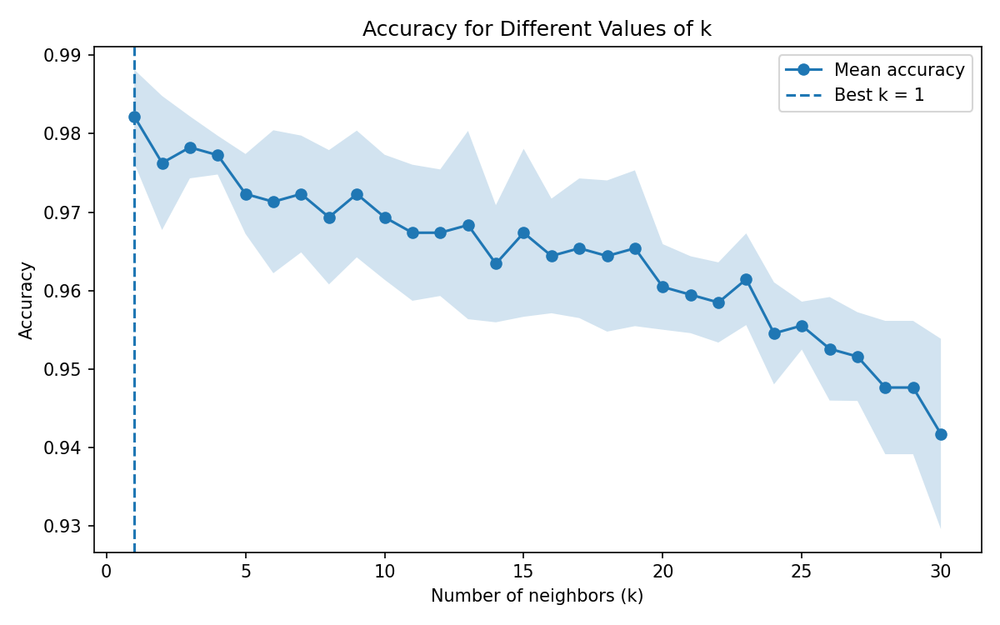
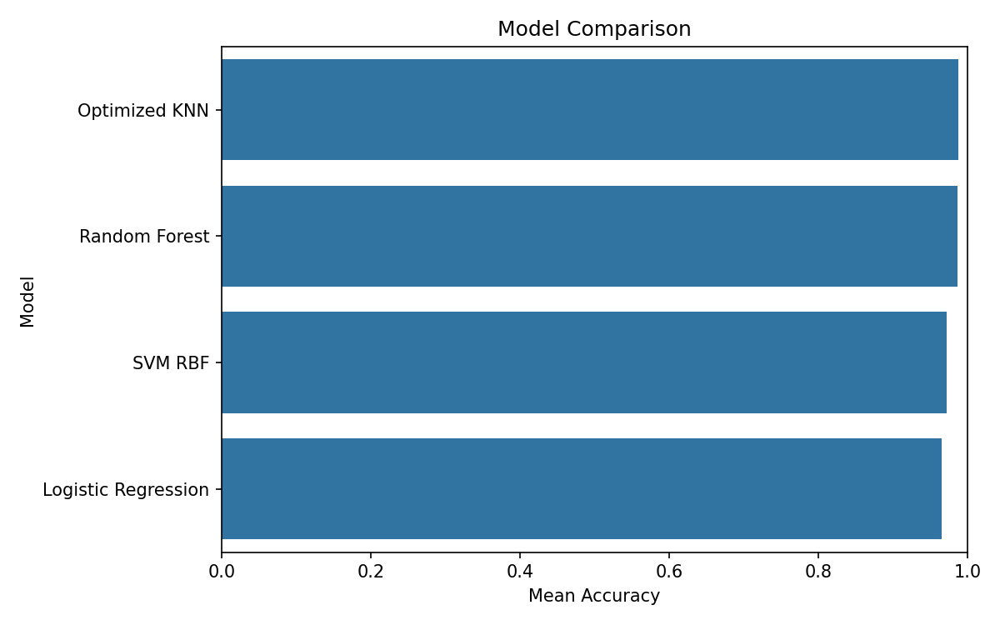

# KNN Classification

End-to-end multi-class classification pipeline built around the K-Nearest Neighbors algorithm: exploration, preprocessing, hyperparameter search, comparison with other models and test-set predictions.



## Problem

Predict the class (`0`, `1`, `2` or `3`) of each observation from seven numerical features (`C1` to `C7`).

| | Train | Test |
|---|---|---|
| Observations | 1,012 | 4,000 |
| Features | 7 | 7 |
| Missing values | none | – |

Because KNN relies on distances between observations, every feature is standardized before training.

## Methodology

1. Exploratory analysis: class balance, correlations, outliers (z-score > 4)
2. Standardization with `StandardScaler`
3. PCA projection for visualization
4. Selection of `k` (1 to 30) with stratified 5-fold cross-validation
5. Comparison of distance metrics
6. Hyperparameter search with `GridSearchCV`
7. Benchmark against Logistic Regression, Random Forest and SVM (RBF)
8. Final evaluation (confusion matrix, learning curve, ROC curves) and test-set predictions

## Results

Cross-validated accuracy of KNN for each distance metric:

| Distance metric | CV accuracy |
|---|---|
| Euclidean | 98.22% |
| **Manhattan** | **98.72%** |
| Chebyshev | 97.82% |
| Minkowski | 98.22% |

Best configuration: **k = 1** with the **Manhattan** distance (98.72%).

**Why k = 1?** A single neighbor usually signals overfitting. Here, accuracy decreases steadily as `k` grows (see the curve above) and the score is measured by cross-validation on held-out folds, which suggests well-separated classes rather than memorization. The learning curve in `figures/` is the check to look at.

The optimized KNN performs on par with Random Forest and slightly above SVM and Logistic Regression:



All other figures (EDA, PCA projection, confusion matrix, learning curve) are in [`figures/`](figures/).

## How to run

```bash
python -m venv .venv
source .venv/bin/activate        # Windows: .venv\Scripts\activate
pip install -r requirements.txt
python Knn.py
```

The script expects `train.csv` and `test.csv` next to `Knn.py`. The datasets are not included in this repository because they cannot be redistributed. Figures, the trained model (`.joblib`), the classification report and `submission.csv` are written to `outputs/`.

## Repository structure

```text
.
├── Knn.py              # full pipeline
├── requirements.txt    # pinned dependencies
└── figures/            # figures generated by the pipeline
```

## Tech stack

Python · NumPy · Pandas · scikit-learn · Matplotlib · Seaborn

## Author

**Noé Payan** — Engineering student in Data & Artificial Intelligence, ESILV (Paris)
